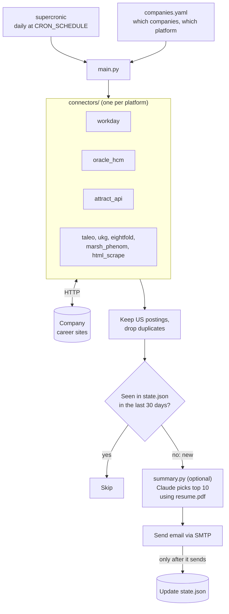
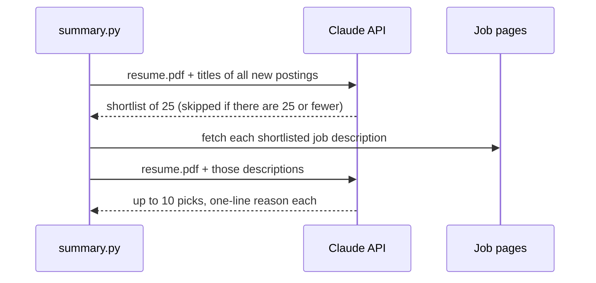

# Daily Job Alert

A small bot that checks the career sites of companies you care about once a
day and emails you only the postings that are **new since yesterday**, each
linked to its description page. Optionally, Claude reads your resume and puts
the ten best-fitting new roles at the top of the email.

I built it to follow entry-level actuarial and underwriting openings at
insurance carriers, and it ships configured for 27 of them, but it works for
any company whose career site runs on a supported platform.

> **Built with AI.** This project was designed and written in pair-programming
> sessions with [Claude Code](https://claude.com/claude-code). `AGENTS.md` is
> the project guide Claude worked from, and the commit history shows how the
> tool grew one connector and one bug fix at a time.

## Features

- **8 career-site platforms**: Workday, Oracle Recruiting Cloud, Taleo,
  UKG Pro (UltiPro), Eightfold, the iCIMS-backed `/api/jobs` API, Marsh's
  Phenom site, and a generic HTML scraper. Adding a company on a supported
  platform is a few lines of YAML; no code changes.
- **Only what's new**: remembers every posting it has seen for 30 days, so
  long-open roles don't reappear when a site's paging hiccups.
- **US postings only**, with locations cleaned up to "City, ST" and dates
  to "Sep 25, 2026".
- **Top matches (optional)**: Claude ranks the day's new postings against
  your `resume.pdf` and explains each pick in one line.
- **Runs itself**: a Docker container with a built-in cron. The server needs
  nothing but Docker and git.
- **Fails loudly, not destructively**: a broken company is logged and skipped
  without touching the others or losing its saved state.

## How it works



1. **Schedule.** [supercronic](https://github.com/aptible/supercronic) runs
   `main.py` inside the container every morning (7:00 America/New_York by
   default).
2. **Fetch.** For each company in `companies.yaml`, `main.py` picks the
   connector named by its `platform` and fetches every open posting.
3. **Filter.** Non-US postings and duplicates are dropped (`jobformat.py`).
   An optional `keywords` list narrows a company to matching titles.
4. **Diff.** Each posting's ID is compared with `state.json`. Anything not
   seen in the last 30 days is new.
5. **Rank (optional).** If `resume.pdf` is present, `summary.py` asks Claude
   to choose up to ten best-fitting roles.
6. **Email, then save.** The email goes out, and only then is `state.json`
   updated, so a failed send retries the same postings tomorrow.

## Quick start: try it on your machine

Requires Python 3.12+ (the Docker image uses 3.12).

```bash
git clone https://github.com/virtualkergan/job-alerts.git
cd job-alerts
pip install -r requirements.txt

python test_connectors.py "Aon"   # fetch one company and print what it found
python test_connectors.py         # smoke-test every company (hits the live sites)
python main.py --dry-run          # print the email it would send; sends nothing, saves nothing
```

The first real run for each company **records a baseline** instead of
emailing you every posting that already exists. From the next run on, you
only hear about new ones. A dry run starting from the empty `state.json` in
this repo therefore shows no new postings; that's expected.

## Deploy it on a server

The scheduled runner is a Docker Compose stack on any always-on machine
(a home server, a Raspberry Pi, a small VPS).

### 1. Get an SMTP sender

Easiest: a Gmail account with an **App Password** (not your normal password).

1. Turn on 2-Step Verification: https://myaccount.google.com/security
2. Create an App Password: https://myaccount.google.com/apppasswords
3. Keep the 16-character password for `.env` below.

Any SMTP provider works (Outlook, a work account, Resend, ...); just change
`SMTP_HOST` and `SMTP_PORT`.

### 2. Start the container

```bash
git clone https://github.com/virtualkergan/job-alerts.git
cd job-alerts
cp .env.example .env              # fill in your SMTP settings
docker compose up -d --build      # runs daily at 7:00am America/New_York
```

### 3. Check on it

```bash
docker compose logs -f                                    # scheduler output and each run's log
docker compose exec job-alerts python main.py --dry-run   # run once now, no email, no state change
docker compose exec job-alerts python main.py             # run once now, for real
```

## Configuration

### Environment variables (`.env`)

| Variable | Required | What it does |
| --- | --- | --- |
| `SMTP_HOST` | yes | e.g. `smtp.gmail.com` |
| `SMTP_PORT` | no | default `587` (STARTTLS) |
| `SMTP_USER` | yes | the sending account |
| `SMTP_PASS` | yes | its password or app password |
| `ALERT_TO` | no | where to send the alert; defaults to `SMTP_USER` |
| `ANTHROPIC_API_KEY` | for Top matches | from https://console.anthropic.com/settings/keys |
| `TZ` | no | default `America/New_York` |
| `CRON_SCHEDULE` | no | default `0 7 * * *`, read in `TZ` (follows DST) |
| `JOB_ARGS` | no | e.g. `--dry-run` to test the schedule safely |

After editing `.env`, run `docker compose up -d` to apply it.

### Companies (`companies.yaml`)

Each entry has a `name`, a `platform`, and that platform's settings. One
example per platform (all taken from the shipped file):

```yaml
- name: "Travelers"               # Workday: from travelers.wd5.myworkdayjobs.com/External
  platform: "workday"
  tenant: "travelers"
  wd_number: "wd5"
  site: "External"
  country: "United States of America"   # optional server-side country filter

- name: "Aon"                     # iCIMS-backed /api/jobs
  platform: "attract_api"
  base_url: "https://jobs.aon.com"

- name: "Chubb"                   # Oracle Recruiting Cloud
  platform: "oracle_hcm"
  host: "fa-ewgu-saasfaprod1.fa.ocs.oraclecloud.com"
  site: "CX_2001"

- name: "Cincinnati Insurance"    # Taleo
  platform: "taleo"
  tenant: "cinfin"
  section: "ex"
  portal: "101430233"

- name: "Acuity"                  # UKG Pro / UltiPro
  platform: "ukg"
  board_url: "https://recruiting2.ultipro.com/HER1001ACFIN/JobBoard/ab33798a-3521-417b-8db8-a8e435c475fa/"

- name: "Liberty Mutual"          # Eightfold
  platform: "eightfold"
  base_url: "https://searchjobs.libertymutualgroup.com"
  domain: "libertymutual.com"

- name: "Fidelity"                # any other site: scrape the search page's HTML
  platform: "html_scrape"
  listing_url: "https://jobs.fidelity.com/en/jobs"
  link_pattern: "/en/jobs/\\d+/"         # regex a job link must match
  card_selector: ".card-job"             # CSS selectors for location and date
  location_selector: ".job-meta li:nth-of-type(2)"
  posted_selector: ".job-meta li:first-child span:nth-of-type(2)"
```

Options any company can use:

- `keywords: ["actuari", "underwrit"]`: only report postings whose title
  contains one of these (case-insensitive).
- `allow_empty: true`: zero openings is normal here (a small employer), so
  don't treat an empty result as a broken connector.

`html_scrape` has more knobs (`pagination`, `page_param`, `offset_param_name`,
`per_page`, `link_selector`); the comments at the top of `companies.yaml` and
the examples in it cover them. `state.json` is keyed by `name`, so renaming a
company starts a fresh baseline for it.

## Top matches (optional)

To get a "Top matches for you" section at the top of each email, on the
server:

1. Copy your resume into the repo folder as `resume.pdf` (it's gitignored).
2. Put `ANTHROPIC_API_KEY=...` in `.env`.
3. `docker compose up -d --build`.



Claude refers to postings only by their number in the prompt, so every link
in the section points to a posting that was actually fetched. A busy day costs
roughly 10 to 25 cents (model: `MODEL` in `summary.py`).

Try it without waiting for the morning run:
`docker compose exec job-alerts python summary.py "Aon"`.

If `resume.pdf` is missing, the section is simply left out. If the Claude call
fails, the email still arrives without it and the run is marked failed in the
logs.

## Make it yours

- **Different companies**: edit `companies.yaml`. Check each new entry with
  `python test_connectors.py "Company Name"` before trusting it.
- **Different kinds of roles**: edit `CRITERIA` at the top of `summary.py`.
  It describes what counts as a match in plain English; it's currently
  written for entry-level actuarial, underwriting and risk roles.
- **Fewer emails**: add `keywords` to the noisy companies.
- **Different time**: set `CRON_SCHEDULE` and `TZ` in `.env`.

## Adding a new platform

If a company's career site isn't on a supported platform, add a connector:

1. Create `connectors/<platform>.py` with
   `fetch_jobs(company_cfg) -> list[dict]`. Each dict needs:
   - `id`: stable across runs (this is what `state.json` remembers)
   - `title`
   - `url`: the job's **description page**, not the application form
   - `locations`: a list of strings, including the country when the site
     gives it
   - `posted`: the date as the site shows it (formatted later)
2. Register it in the `CONNECTORS` dict in `main.py`.
3. Add a company that uses it to `companies.yaml` and run
   `python test_connectors.py "Company Name"`.

The quickest way to find a site's job feed is usually your browser's
developer tools: open the Network tab, load the careers search page, and
look for the JSON request that returns the job list.

## Updating the server

Make changes on your own machine, push, then on the server:

```bash
git pull
docker compose up -d --build      # only needed when code changed
```

`companies.yaml` is mounted into the container, so a change to it takes
effect on the next run with just `git pull`. Changes to `main.py`,
`summary.py`, `jobformat.py`, `connectors/` or `requirements.txt` need the
rebuild.

### Files that live only on the server

`.env` and `resume.pdf` are gitignored, so `git pull` never brings them over:
create them on the server yourself.

`state.json` is in git so the bind mount has a file to attach to, but the
server's copy is the live one and will always show as modified there. Don't
commit `state.json` from another machine, or the server's next `git pull`
will conflict with it.

## Behavior worth knowing

- **Mount targets must exist.** `state.json` and `resume.pdf` are
  bind-mounted. If either is missing when the container starts, Docker
  creates a *directory* with that name. Delete it and copy the file in.
- **Failures are isolated.** If one company's site fails, the others still
  report and save state. The failing company keeps its old state, and the
  run exits non-zero so it shows as a failed job in `docker compose logs`,
  on a line starting with `[Company Name]` (or `[summary]` for Claude errors).
- **An empty result counts as an error** for a company that had postings
  before, unless it sets `allow_empty: true`. This stops a broken scraper
  from wiping its history.
- **Missed days don't lose postings.** If the server is down at run time,
  that run is skipped (cron doesn't catch up), and the next run reports
  everything new since.
- **Unknown locations are kept.** A posting is dropped as non-US only when
  none of its locations is in the US and at least one is clearly elsewhere.
  If a location can't be read, it shows as "Location not listed" rather
  than disappearing.
- **Testing the schedule**: set `CRON_SCHEDULE=* * * * *` and
  `JOB_ARGS=--dry-run` in `.env`, `docker compose up -d`, watch the logs,
  then remove both lines and `up -d` again.
- **Locally, stick to `--dry-run`.** A real `python main.py` on your laptop
  would send a second email and rewrite your local `state.json`, which isn't
  the server's.

## Responsible use

This tool reads public career pages and the JSON endpoints those pages call
themselves. Keep it to about one run a day, check each site's terms of use
before adding it, and don't use it to republish postings. Some sites block
automated requests on purpose (Progressive sits behind a Cloudflare
challenge, for example), and this project leaves those alone rather than
working around them.

## License

[MIT](LICENSE)
